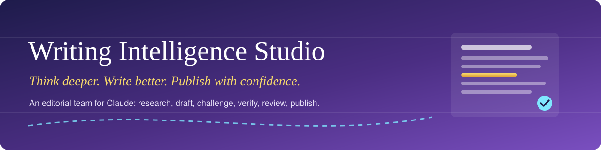

[](CHANGELOG.md)
[](LICENSE)
[](https://claude.ai/directory)
[](#-whats-inside)
[](skills/text-quality-check/scripts/check_text.py)
[](tests/test_check_text.py)

# ✍️ Writing Intelligence Studio

**Writing Intelligence Studio turns Claude into a small editorial team:** an intake editor, a researcher, an author, a sceptical senior editor, a copy editor and a fact-checker. It plans, drafts, challenges, edits, verifies and reviews substantial writing (essays, articles, blog posts, reports, white papers, technical guides, newsletters, LinkedIn posts and book chapters), and you approve every change.

> 🎯 **Purpose before prose. Evidence before claims. Original thinking before summaries.**

---

## 📸 Screenshots

### 🏠 Start with an idea, not a template
Describe what you want to write in your own words. The studio works out the format, audience and approach.

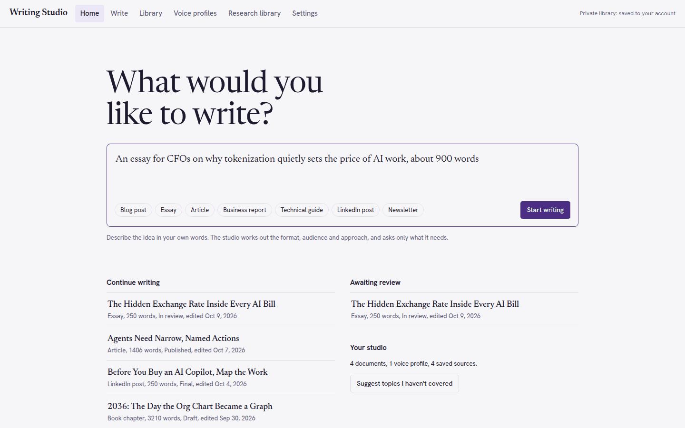

### 🧭 Brief: the studio asks only what matters
Claude infers the brief and asks at most three questions that would change the result.

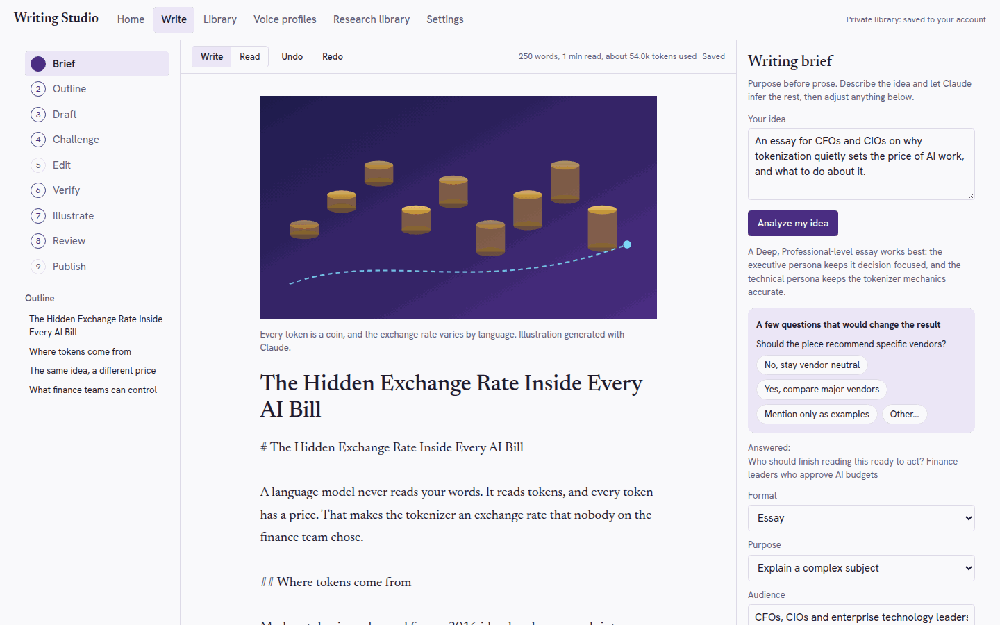

### 🔍 Verify: citations come only from real sources
Every citation maps to a source you attached. Unsupported claims are flagged, never invented.

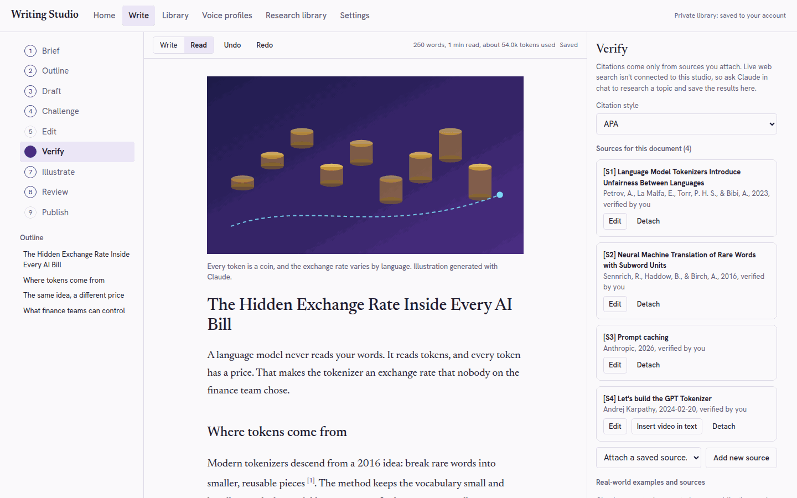

### ✏️ Edit: every change is tracked
See exactly what an edit adds (green) and removes (red) before you accept it.

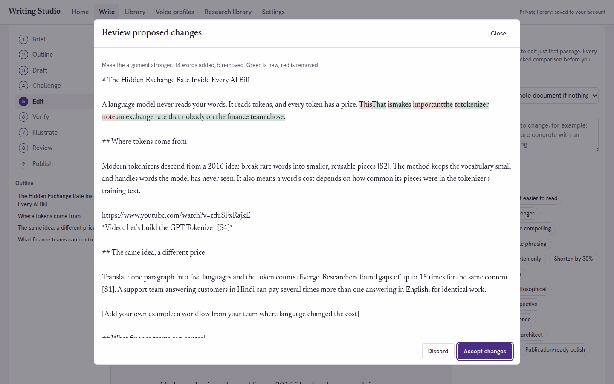

### 📊 Review: readability, originality and editorial quality
Instant reading-ease scores, AI-style phrase detection, copied-wording checks and an editor's 10-point review.

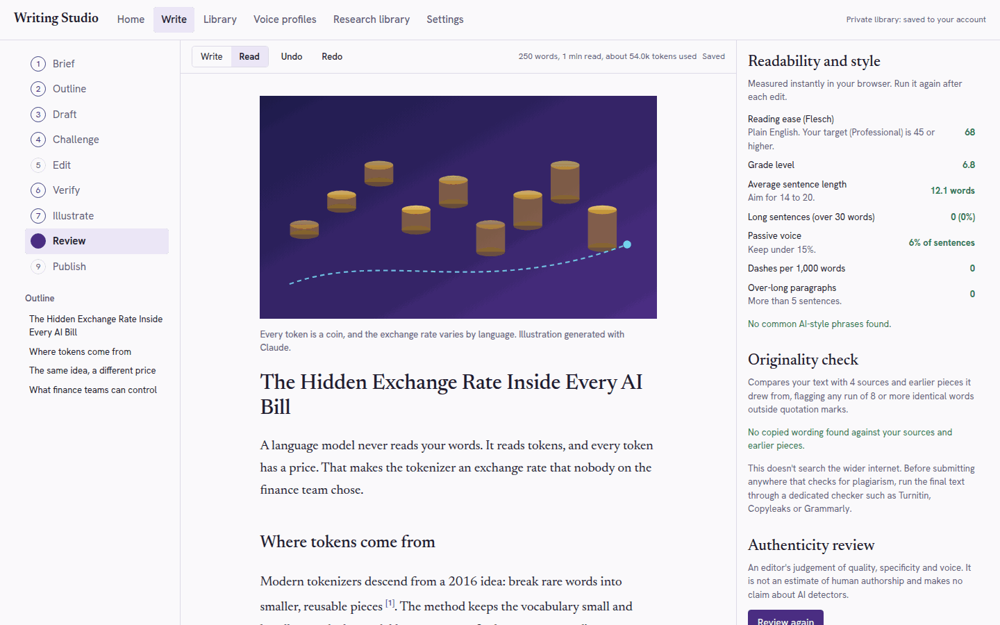

### 🚀 Publish: keywords, hashtags and timing
Search title, meta description, LinkedIn hashtags and the best time to post for your readers' region.

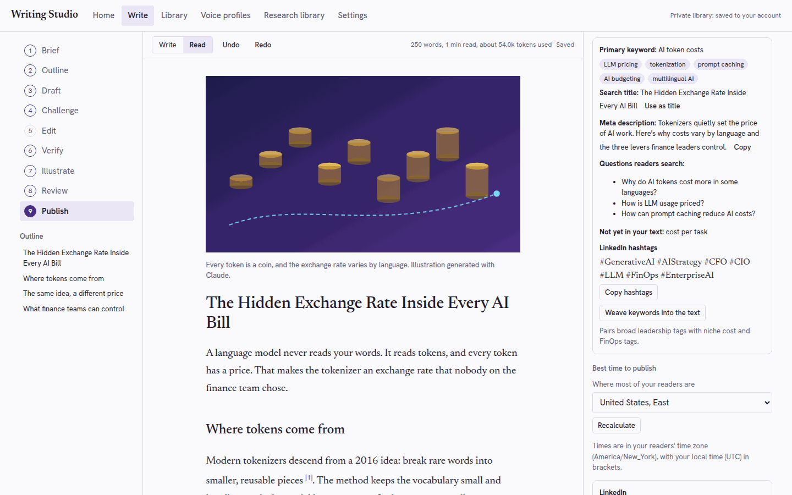

### 📚 Library: everything you've written, searchable
Search by exact words or by meaning, filter by format and status, and combine pieces into a long-form report.

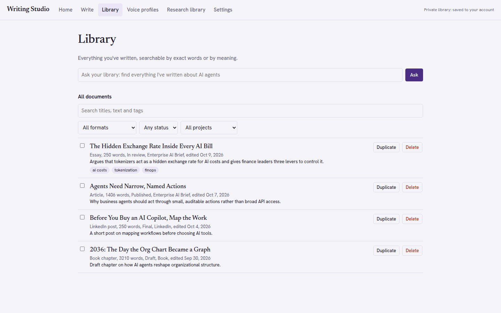

### 🌙 Challenge, in dark mode
A demanding editor finds weaknesses, counterarguments and missing context, each with a one-click fix.

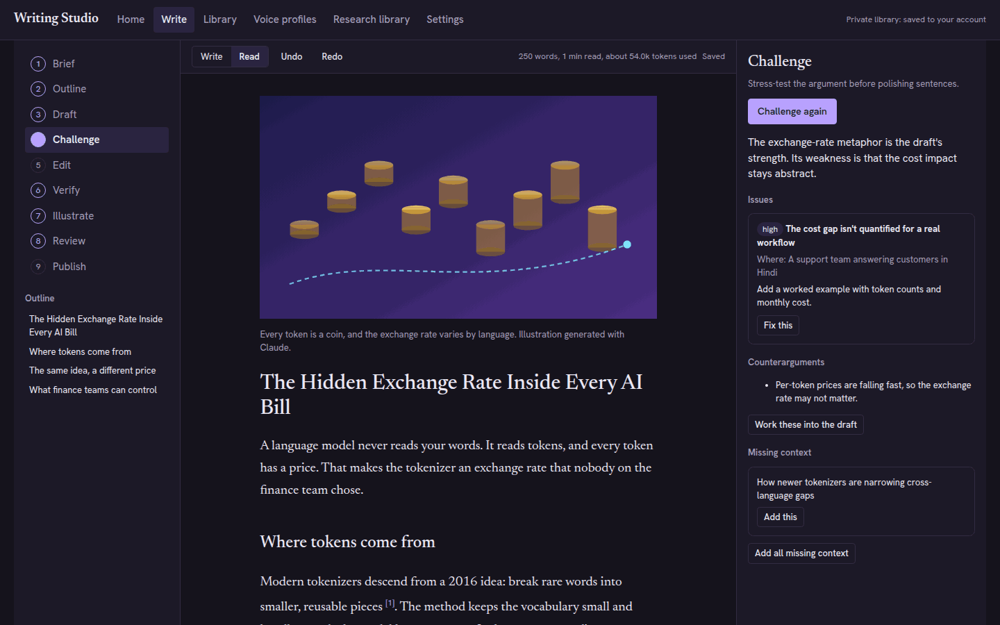

*Screenshots use a sample document. Its four sources are real, published works.*

---

## ✨ Features

| | Feature | What it does |
|---|---|---|
| 🧭 | **Smart intake** | Infers format, purpose, audience, tone, depth, reading level and length; asks at most three questions |
| 🎭 | **Seven editorial personas** | Journalist, Philosopher, Technical expert, Researcher, Literary writer, Executive thought leader, Human editor. Combine up to three |
| 🔬 | **Depth control** | Standard, Deep (mechanism, example, implication, objection for every point) or Expert |
| 📚 | **Evidence you can check** | Cites only real sources with `[S1]` markers; flags unsupported claims `[needs source]`; APA, MLA, Chicago, Harvard, IEEE or inline links |
| 🎥 | **Video sources** | Add YouTube videos as sources and embed them in the text |
| 🧪 | **Challenge step** | Weaknesses, counterarguments and missing context, each with a fix |
| 🔁 | **Tracked edits** | Word-level before/after comparison; every accepted edit saves a version first |
| 📖 | **Readability targets** | Plain, General, Professional or Specialist reading level, measured with Flesch scores |
| 🚫 | **AI-pattern removal** | Avoids about 30 formulaic patterns ("delve", "In today's fast-paced world", "It's not X, it's Y") |
| 🧬 | **Originality check** | Flags any 8-word run copied from your sources or earlier drafts |
| 🎨 | **Original illustrations** | Vector artwork with alt text, caption and a prompt for photo generators |
| 📈 | **Reach tools** | Keywords, search title, meta description, LinkedIn hashtags, posting times by region |
| 🗂️ | **Private library** | Documents, versions, voice profiles and sources, saved to your account |
| 🧮 | **Usage visibility** | Estimated tokens per document and per request |

---

## 🧩 What's inside

| Skill | Use it when | Runs code? |
|---|---|---|
| 📝 [`writing-studio`](skills/writing-studio/SKILL.md) | You ask Claude to write, improve, fact-check or prepare a piece for publication | No, instructions only |
| 📏 [`text-quality-check`](skills/text-quality-check/SKILL.md) | You want readability scores, AI-style phrases found or copied wording checked | Yes, a local Python script you ask for |
| 🖥️ [`studio-workspace`](skills/studio-workspace/SKILL.md) | You want the interactive editor and private document library | A web page published inside Claude |

### 💬 Example requests

```text
Write a 1,200-word essay for CIOs on why enterprise AI pilots stall. Deep, professional reading level.
Challenge my draft and add the missing context.
Check this article's readability and find any AI-style phrasing.
Turn this report into a LinkedIn post with hashtags and the best time to post for readers in India.
Open the writing studio.
```

---

## 🛠️ Technical details

### Architecture

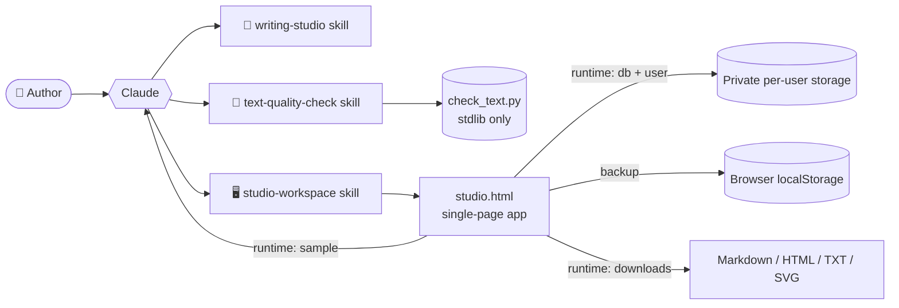

### The nine-step workflow

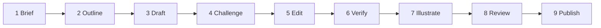

Steps can be skipped, reordered or repeated.

### Tech stack

| Layer | Technology |
|---|---|
| Plugin format | Claude plugin bundle: `.claude-plugin/plugin.json` manifest plus `skills/*/SKILL.md` |
| Workspace UI | One self-contained HTML file: vanilla JavaScript (ES2020), CSS custom properties, no framework, no build step |
| Typography | Newsreader (writing) and Hanken Grotesk (interface), from Google Fonts |
| AI calls | Claude artifact runtime `sample` capability, with streaming output and JSON mode |
| Storage | Runtime `db` capability under a per-user private path, mirrored to `localStorage` |
| Quality script | Python 3, standard library only |
| Tests | Plain-Python unit tests plus ten manual scenarios in [`docs/TEST-SCENARIOS.md`](docs/TEST-SCENARIOS.md) |

### Algorithms

| Capability | How it works |
|---|---|
| **Reading ease** | Flesch: `206.835 − 1.015 × (words ÷ sentences) − 84.6 × (syllables ÷ words)` |
| **Grade level** | Flesch–Kincaid: `0.39 × (words ÷ sentences) + 11.8 × (syllables ÷ words) − 15.59` |
| **Syllables** | Vowel-group heuristic with silent-e and suffix handling |
| **Passive voice** | Pattern match: form of *to be*, optional adverb, past participle |
| **AI-style phrases** | 31 regular expressions for formulaic constructions |
| **Originality** | 8-word shingles from each source; consecutive matches merged into passages; text inside quotation marks excluded |
| **Tracked changes** | Longest-common-subsequence diff on word tokens; paragraph-first for long documents to stay fast and memory-safe |
| **Related documents** | Keyword-set Jaccard similarity across your library |
| **Posting times** | Times given in the readers' time zone and converted to yours with `Intl.DateTimeFormat` offsets |

### Data model (workspace)

| Collection | Holds |
|---|---|
| `docs` | Brief, plan, body (Markdown), sources, illustration, review, fact-check, keywords, timing, usage, status |
| `versions` | Snapshots saved before drafts and accepted edits (last 30 per document) |
| `voices` | Voice profiles built from your own writing samples |
| `sources` | Title, author, publisher, date, URL or DOI, type, excerpts, verification flag |
| `errors` | Technical error details, kept privately for troubleshooting |

### Repository layout

```text
writing-intelligence-studio/
├── .claude-plugin/
│   └── plugin.json              # Plugin manifest
├── skills/
│   ├── writing-studio/
│   │   ├── SKILL.md             # Nine-step editorial workflow
│   │   └── references/          # Personas, style, citations, reach
│   ├── text-quality-check/
│   │   ├── SKILL.md
│   │   └── scripts/check_text.py
│   └── studio-workspace/
│       ├── SKILL.md
│       └── assets/studio.html   # The interactive workspace
├── tests/test_check_text.py
├── docs/                        # Banner, screenshots, test scenarios
├── README.md · LICENSE · PRIVACY.md · CHANGELOG.md
```

### Run the quality check yourself

```bash
python3 skills/text-quality-check/scripts/check_text.py draft.md --level General --sources notes.txt
python3 tests/test_check_text.py
```

---

## 📦 Installation

Install from the Claude directory once listed. To try it locally in Claude Code:

```bash
claude --plugin-dir ./writing-intelligence-studio
```

---

## 🔐 What this plugin runs, sends and fetches

- **Skills** are instructions to Claude. They run no code on their own.
- **`text-quality-check`** includes `scripts/check_text.py`, which Claude runs only when you ask for a quality check. It uses the Python standard library, reads the files you give it, prints a report and sends nothing over the network.
- **`studio-workspace`** includes `assets/studio.html`, a readable single-page app. When published inside a Claude app it:
  - sends your brief, text and sources to Claude through that app's runtime, using your own Claude usage;
  - stores your documents in the app's private per-user storage, with a backup in your browser;
  - records technical error details (no document text) in that same private storage when something fails;
  - loads two fonts from Google Fonts;
  - opens Google or YouTube search links only when you click them.
- No analytics, tracking, hooks, MCP servers, package installs or credentials.
- This README displays badge images from shields.io when viewed on GitHub.

See [PRIVACY.md](PRIVACY.md) for details.

---

## ⚖️ Honest limits

- 🌐 **Research is only as current as your tools.** Without a web search tool, Claude asks you for sources instead of guessing.
- 🧬 **The originality check covers your sources and earlier drafts, not the whole internet.** Run a dedicated plagiarism checker before formal submission.
- 🧑‍⚖️ **The editorial review measures quality, specificity and voice.** It is not an AI-detection score and makes no promise about detectors.
- 🕒 **Posting-time advice is general guidance.** Your own platform analytics are a better guide once you have them.
- 🧮 **Token counts are estimates** (about 4 characters per token), because exact counts aren't reported to the page.

---

## 📄 License

Released under the [MIT License](LICENSE).

---

<sub>

**Built by [Sumit Mattey](https://www.linkedin.com/in/sumitmattey)** · VP, Salesforce Practice · [LinkedIn](https://www.linkedin.com/in/sumitmattey) · [GitHub](https://github.com/mattey2026) · sumit@matteys.com

</sub>
