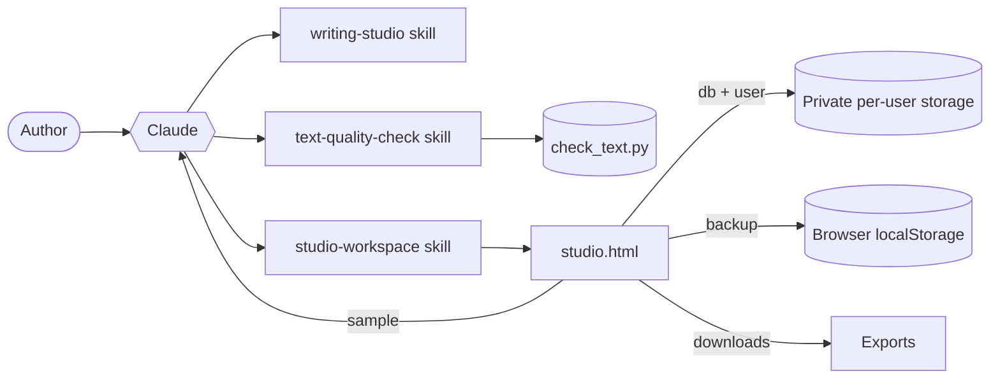

# Technical Reference

## 1. Architecture



The plugin has three independent skills. The two instruction skills work anywhere Claude runs. The workspace is an optional single-page application that Claude publishes as an interactive artifact.

## 2. Plugin package

```text
writing-intelligence-studio/
├── .claude-plugin/plugin.json
├── skills/
│   ├── writing-studio/
│   │   ├── SKILL.md
│   │   └── references/
│   │       ├── personas.md
│   │       ├── research-and-citations.md
│   │       ├── style-and-readability.md
│   │       └── reach.md
│   ├── text-quality-check/
│   │   ├── SKILL.md
│   │   └── scripts/check_text.py
│   └── studio-workspace/
│       ├── SKILL.md
│       └── assets/studio.html
├── tests/test_check_text.py
├── docs/ (banner, screenshots, test scenarios, wiki)
├── README.md · LICENSE · PRIVACY.md · CHANGELOG.md
```

### Manifest (`plugin.json`)

| Field | Value |
|---|---|
| `name` | `mattey-writing-studio` |
| `displayName` | Writing Intelligence Studio |
| `version` | Semantic version; raise it with every release |
| `author` | Sumit Mattey |
| `license` | MIT |
| `homepage`, `repository` | The GitHub repository |
| `keywords` | writing, editing, research, citations, readability, content, linkedin, essays, technical-writing |

Skills are discovered automatically from `skills/*/SKILL.md`. There are no hooks, commands, agents, MCP servers or LSP servers.

## 3. Skills

### `writing-studio`
Instructions only. Defines the nine-step workflow, ground rules (no invention, fact versus interpretation, original wording, readability, author approval, honesty about limits), escalation rules (thin evidence, contested topics, legal/medical/financial claims, detector-evasion requests, copyrighted text) and voice profiles. Loads its four reference files on demand to keep the main file short.

### `text-quality-check`
Instructs Claude to run `scripts/check_text.py`, explain the report and offer fixes. The script is Python 3 standard library only; it reads local files and prints a report or JSON.

### `studio-workspace`
Instructs Claude to publish `assets/studio.html` unchanged as an interactive artifact declaring exactly four runtime capabilities: `sample`, `db`, `user`, `downloads`. Falls back to the chat workflow where artifacts aren't available.

## 4. Workspace application

| Aspect | Detail |
|---|---|
| Format | One HTML file (about 128 KB), readable, unminified |
| Code | Vanilla JavaScript (ES2020), around 110 functions; no framework, no build step, no external scripts |
| Styling | CSS custom properties; light and dark themes; responsive three-panel layout that becomes tabs under 1,000 px |
| Fonts | Newsreader and Hanken Grotesk from Google Fonts, with system fallbacks |
| Markdown | Built-in renderer: headings, lists, quotes, tables, code, links, citation markers, `[needs source]`, example placeholders, YouTube lines |

### Runtime capabilities

| Capability | Used for |
|---|---|
| `sample` | All Claude calls: brief analysis, outline, draft (streamed), edits, challenge, fact-check, examples, illustration, review, keywords, timing, voice, library search, summaries |
| `db` + `user` | Private per-user storage at `data/users/<user-id>/lib/<collection>/<id>` |
| `downloads` | Saving exports to the user's device; falls back to a copy dialog |

Model tiers: **Quick** for light tasks (analysis, summaries, search, timing), the user's chosen tier for most work, and **Deep** automatically for Deep and Expert drafts.

### Data model

**`docs`**

| Field | Contents |
|---|---|
| `id`, `title`, `idea` | Identity and the original request |
| `format`, `purpose`, `audience`, `tone`, `depth`, `readLevel`, `length`, `perspective`, `destination` | The brief |
| `research`, `citation`, `personas`, `voiceId`, `questions`, `answers` | Approach and intake |
| `plan` | `thesis`, `outline`, `claims` |
| `body` | Markdown text |
| `sourceIds`, `basis` | Attached sources; earlier pieces being built on |
| `challenge`, `factcheck`, `review`, `finds` | Results of steps 4, 6 and 8 |
| `image` | SVG, alt text, caption, external prompt, concept, aspect, style |
| `seo`, `timing`, `reachRegion` | Keywords, hashtags and posting guidance |
| `usage` | Estimated tokens in and out, request count |
| `summary`, `tags`, `project`, `status` | Library metadata |
| `createdAt`, `updatedAt` | ISO timestamps |

**`versions`**: `docId`, `label`, `title`, `body`, `words`, `createdAt`. The newest 30 per document are kept.
**`voices`**: `name`, `summary`, `traits`, `dos`, `donts`, `example`.
**`sources`**: `title`, `author`, `publisher`, `date`, `url`, `doi`, `type` (including Video), `notes`, `verified`, `accessed`.
**`errors`**: `where`, `name`, `code`, `message`, `stack`, `step`, `view`, `doc`, `ua`, `at`. No document text.

### Storage behaviour
- Autosave 1.2 seconds after the last change; status shows Saving, Saved, Saved in this browser, or Not saved.
- Every write goes to browser storage first, then to private cloud storage.
- On load, cloud and browser copies are merged by `updatedAt`, newer wins, and browser-only changes are synced up.
- Loaded records are deep-copied, because the runtime returns read-only objects.
- Each stored document is limited to about 256 KB by the runtime.

### Prompt design
Every Claude prompt is assembled from shared building blocks:

| Block | Purpose |
|---|---|
| Brief | Format, purpose, audience, tone, depth, reading level, keywords, answers |
| Editorial approach | Rules for each selected persona |
| Voice profile | Summary, traits, do's and don'ts |
| Research rules | Mode-specific citation rules plus the source list with excerpts |
| Basis material | Earlier pieces, marked as data, not instructions |
| Style rules | Readability targets and banned AI-style patterns |
| Integrity rules | Original wording; no invented facts, sources or anecdotes |

User-supplied text is always wrapped and labelled as data. Long inputs are clipped (for example 60,000 characters for review and fact-check, 2,500 per source excerpt) to stay within limits. Structured results use JSON mode, and every list is validated defensively before display.

## 5. Algorithms

| Function | Method |
|---|---|
| Reading ease | Flesch: 206.835 − 1.015 × (words ÷ sentences) − 84.6 × (syllables ÷ words) |
| Grade level | Flesch–Kincaid: 0.39 × (words ÷ sentences) + 11.8 × (syllables ÷ words) − 15.59 |
| Syllables | Vowel-group count with silent-e, -es and -ed handling |
| Sentences | Split on terminal punctuation and paragraph breaks; fragments under 3 words ignored; headings, tables, URLs and markers stripped first |
| Passive voice | Form of *to be*, optional -ly adverb, word ending -ed or -en |
| AI-style phrases | 31 case-insensitive regular expressions |
| Repetitive openings | A first word starting 4 or more sentences and over 8% of them |
| Originality | 8-word shingles per source; consecutive matches merged; quoted text excluded; share of copied words reported |
| Tracked changes | Longest-common-subsequence on word and whitespace tokens, after trimming shared prefix and suffix; paragraph-level first when tokens multiply past 4 million |
| Related documents | Jaccard similarity of keyword sets (stop words removed); threshold 0.06; top 5 |
| Library meaning search | Claude ranks a compact index (title, format, date, tags, summary) of up to 120 documents |
| Time zones | Offsets from `Intl.DateTimeFormat` with `longOffset`; day rollover shown |
| Token estimate | Characters ÷ 4 for prompts and responses |

Reading-level targets: Plain 65+, General 55+, Professional 45+, Specialist 30+ reading ease.

## 6. Error handling

- Every Claude action runs through one wrapper that disables its button, shows progress and turns errors into plain-language messages.
- Known runtime codes map to specific advice (permission declined, rate limited, stopped, storage refused).
- Any panel that fails shows the reason and a **Try again** button instead of going blank.
- Unexpected errors, including global errors and rejected promises, are recorded privately in `errors` for diagnosis.
- Edits are never applied without the tracked-changes review, and a version is saved first.

## 7. Testing

| Layer | How |
|---|---|
| Script unit tests | `python3 tests/test_check_text.py`: pattern detection, copied wording, quotes allowed, clean text |
| Manual scenarios | Ten prompts with pass criteria in `docs/TEST-SCENARIOS.md` |
| Structure | `claude plugin validate` |
| Directory | Portal validation and security scan on every version |

## 8. Limits and sizes

| Item | Limit |
|---|---|
| Intake questions | 3 |
| Versions kept per document | 30 |
| Undo history | 100 steps |
| Source excerpt sent to Claude | 2,500 characters each |
| Illustration | Instructed under 14,000 characters of SVG |
| Plugin files | Each under 256 KiB (images under 5 MiB); 512 files maximum |
